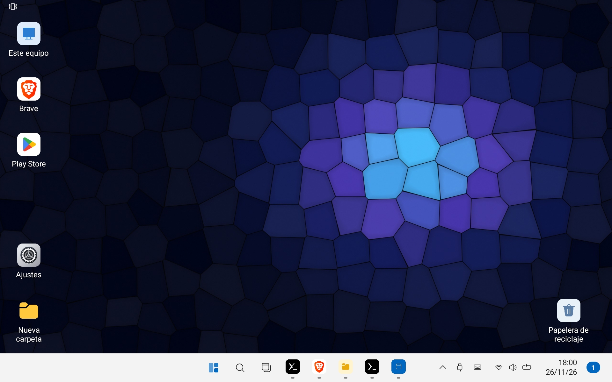
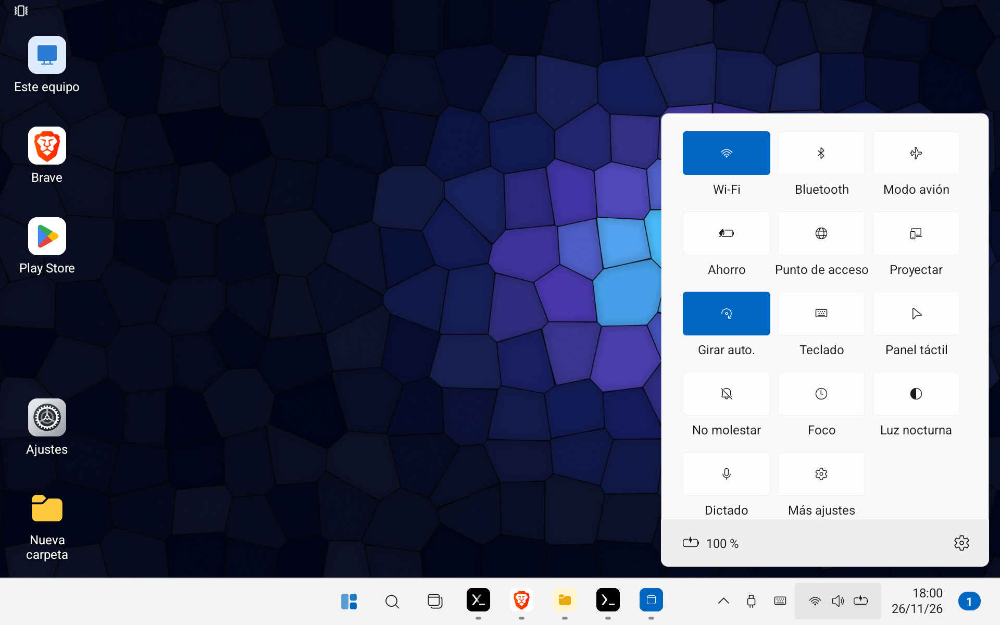
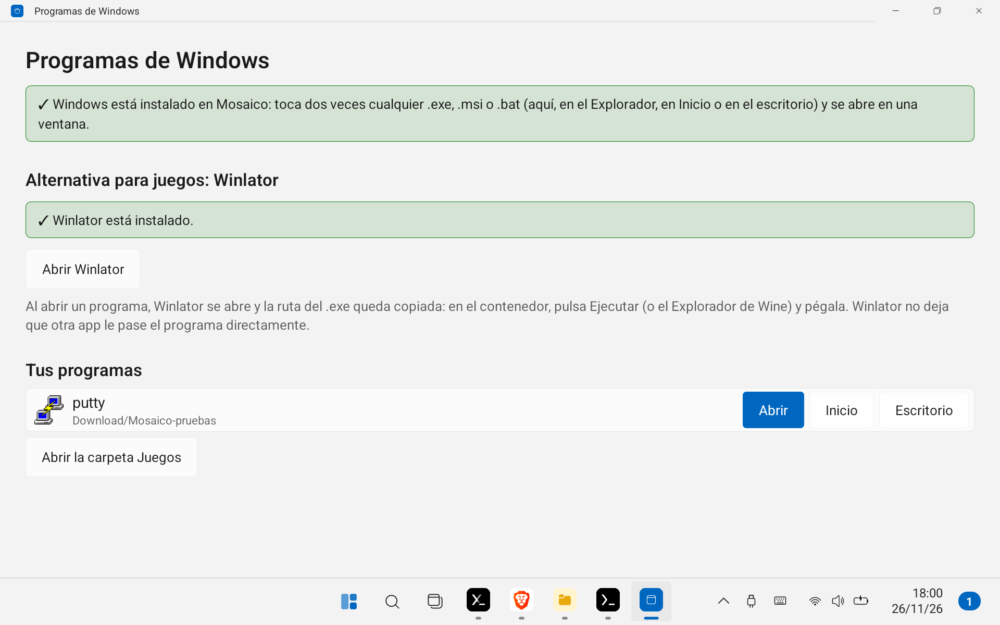
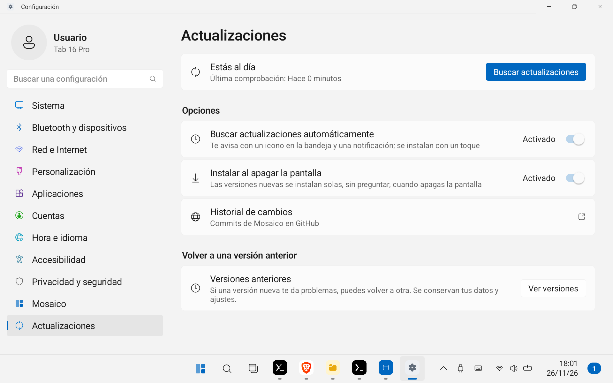

# Mosaico

**Convierte tu tableta Android en un PC.** Mosaico es un lanzador (pantalla de inicio) para Android con
escritorio, barra de tareas, menú Inicio, ventanas que se mueven y se ajustan a los bordes, Explorador de
archivos con pestañas y muchas apps propias. Además abre **programas de Windows (.exe)** y **apps de Linux**
en ventanas, sin pasos a mano.

Pensado para usarse con los dedos, sin teclado ni ratón (aunque también funcionan).

## Qué incluye

- **Escritorio y barra de tareas** con Inicio, búsqueda, bandeja, centro de notificaciones y calendario.
- **Ventanas de verdad** para cualquier app de Android: mover con el dedo, ajustar a mitades y cuartos,
  maximizar, minimizar, varias ventanas de la misma app y Vista de tareas.
- **Configuración rápida** con Wi‑Fi, Bluetooth, modo avión, ahorro, luz nocturna y volumen por app.
- **Apps propias**: Explorador (pestañas, carpetas de red, zip/7z/rar), Bloc de notas, Fotos con editor,
  Paint, Reloj, Reproductor, visor de documentos y PDF, Calculadora, Recortes, grabación de pantalla,
  Administrador de tareas, Terminal y Tienda.
- **Programas de Windows**: toca dos veces un `.exe`, `.msi` o `.bat` y se abre en una ventana. La primera
  vez Mosaico instala lo necesario solo, con una barra de progreso.
- **Linux**: Debian o Ubuntu con escritorio, terminal y sus apps en ventanas, como WSL en Windows.
- **Actualizaciones automáticas**: se instalan solas al apagar la pantalla, y puedes volver a una versión
  anterior sin perder tus ajustes.

| Configuración rápida | Programas de Windows | Actualizaciones |
|---|---|---|
|  |  |  |

## Cómo instalarlo

1. En la tableta, descarga **[Mosaico.apk](Mosaico.apk)** (o la última versión en
   [Releases](../../releases)).
2. Ábrelo y permite instalar apps de este origen si Android lo pide.
3. Abre Mosaico y sigue el asistente: un solo botón deja todos los permisos listos. Necesitas una Wi‑Fi
   solo esa vez.
4. Cuando Android pregunte qué pantalla de inicio usar, elige **Mosaico** y "Siempre".

Requisitos: Android 10 o superior. Recomendado: tableta con Android 12 o superior y 6 GB de RAM o más.
Los programas de Windows necesitan un procesador ARM de 64 bits (casi todas las tabletas actuales).

## Versiones

Cada versión está en [Releases](../../releases) con su APK. `LEEME.txt` indica la versión más reciente.
Mosaico se actualiza solo desde la propia app (Configuración › Actualizaciones).

## Aviso legal

© 2026 ezradesign. Todos los derechos reservados. Mosaico es software propietario: este repositorio solo
publica el APK compilado, las notas de versión y estas capturas. No se permite copiar, modificar,
redistribuir ni descompilar la app sin permiso por escrito.

Mosaico es un proyecto independiente y **no está afiliado, patrocinado ni respaldado por Microsoft**.
Windows es una marca registrada de Microsoft Corporation. Android es una marca de Google LLC.

## Software de terceros

Mosaico incluye estas bibliotecas de código abierto:

| Componente | Licencia |
|---|---|
| Fluent UI System Icons (Microsoft) | MIT |
| AndroidHiddenApiBypass (LSPosed) | Apache 2.0 |
| libadb-android (Muntashir Al-Islam) | Apache 2.0 |
| smbj | Apache 2.0 |
| Apache Commons Compress | Apache 2.0 |
| XZ for Java | Dominio público |
| junrar | Licencia UnRAR |
| Bouncy Castle | MIT |

Mosaico **no incluye** estos programas: los descarga e instala aparte, desde sus fuentes oficiales, solo si
el usuario lo pide. Cada uno se rige por su propia licencia:

| Programa | Licencia | De dónde se descarga |
|---|---|---|
| Termux y Termux:X11 | GPLv3 | GitHub oficial de Termux |
| Wine (hangover-wine) | LGPL 2.1 | Repositorio oficial de paquetes de Termux |
| Box64 y FEX (dentro de Hangover) | MIT | Repositorio oficial de paquetes de Termux |
| Debian / Ubuntu (proot-distro) | Varias (libres) | Servidores oficiales de cada distribución |
| Winlator (opcional) | LGPL 2.1 | GitHub oficial de Winlator |
